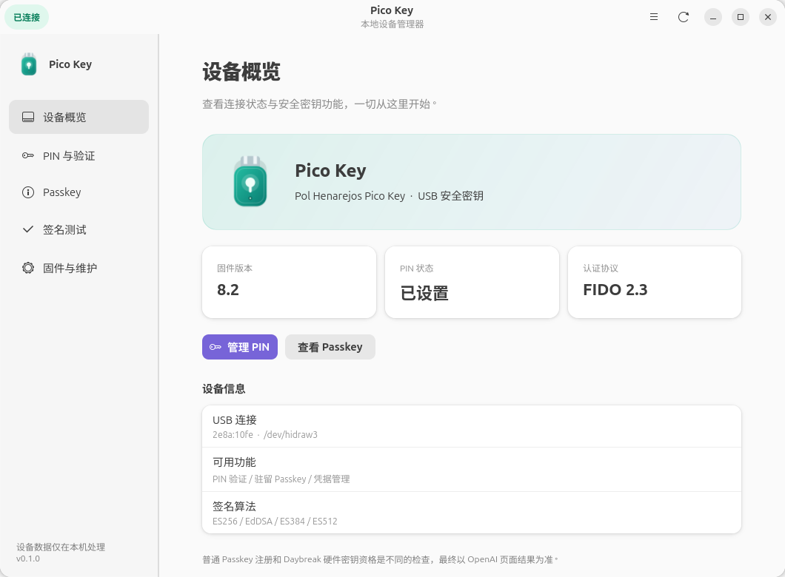
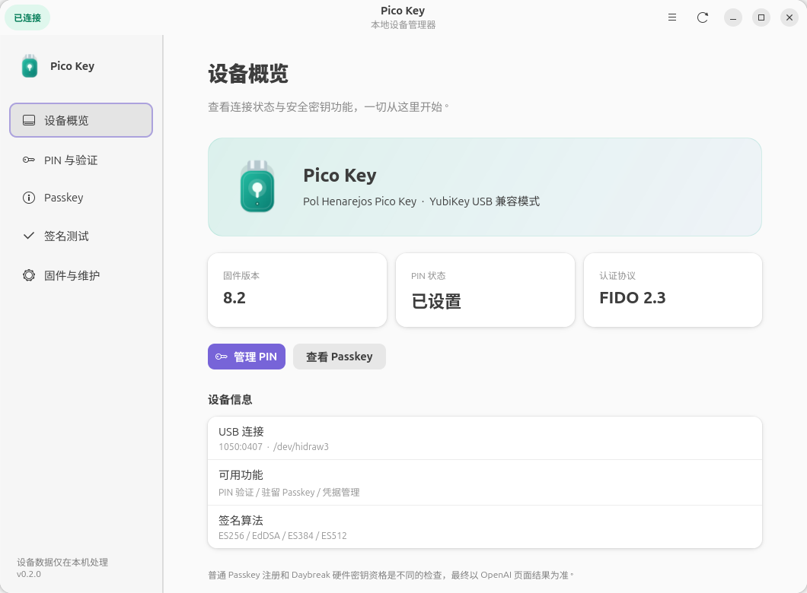

# Pico Key 管理器

用于 Raspberry Pi Pico 2 W 安全密钥的本地桌面管理工具，配套保存实验固件、完整固件源码、补丁和硬件测试脚本。



## 功能

- 自动识别 USB 安全密钥，查看固件版本、PIN 状态、协议和算法。
- 支持 Pico 原生身份和 YubiKey USB 兼容模式，概览显示当前模式。
- 设置、修改、验证 PIN；PIN 不保存到配置或日志。
- 用 PIN 解锁驻留 Passkey 列表，查看网站和账号，删除选定凭据。
- 使用临时非驻留凭据，验证 PIN、物理按键和 ES256 / EdDSA 登录签名。
- 校验并写入 Pico 2 W 的 UF2 固件。
- 明确确认后重置 FIDO 功能；重置会清空 PIN 和 FIDO 凭据。
- 导出不含 PIN、账号列表或凭据 ID 的诊断信息。

## 安装桌面工具

已在 Ubuntu 26.04、GTK 4.22、libadwaita 1.9、Python 3.14 下验证。
需要 `uv`、系统 Python、PyGObject、GTK 4、libadwaita，以及 `desktop-file-utils`。

Ubuntu 的系统组件可通过以下命令安装：

```bash
sudo apt install python3-gi gir1.2-gtk-4.0 gir1.2-adw-1 desktop-file-utils
```

安装 [uv](https://docs.astral.sh/uv/getting-started/installation/) 后，在仓库根目录运行：

```bash
bash install-desktop.sh
```

随后在应用菜单搜索 **Pico Key**，或运行 `~/.local/bin/pico-key-manager`。
运行环境保存在仓库下的 `.venv/`，不依赖临时目录。移动仓库后重新运行安装脚本即可更新启动器。

## 固件与源码

`firmware/pico_fido_pico2_w_EXPERIMENTAL.uf2` 是实验固件，校验值见 `firmware/SHA256SUMS`。
`firmware/source/` 包含这份固件对应的 Pico FIDO、PicoKeys SDK 完整源码快照及本项目修改；原始提交、依赖提交和编译选项见 `firmware/build-manifest.json`。

修改保存在 `patches/`，并已应用到源码快照：

1. 修复 Pico 2 W 的 CYW43 LED 驱动编号可见性。
2. 强制物理确认时设置默认 30 秒等待时间。
3. 补齐未传 PIN 授权参数时创建凭据的物理确认检查。
4. 修正 GetInfo 版本标记、启用接口的传输声明和外置设备选项，并验证 CBOR 规范排序。

默认固件使用 PicoKeys 原有 USB 身份与 attestation。另提供上游 `VIDPID=Yubikey5` 选项的 USB 兼容固件：只把 VID/PID 改为 `1050:0407`，产品名仍为 Pico Key，AAGUID 和 attestation 实现保持 PicoKeys 原样。
**兼容模式不能提供 Yubico 厂商认证，也不保证 OpenAI Daybreak 接受。** 没有烧写 OTP 或启用 Secure Lock。

| 模式 | USB VID/PID | 固件 |
| --- | --- | --- |
| 原生（默认） | `2e8a:10fe` | `pico_fido_pico2_w_EXPERIMENTAL.uf2` |
| YubiKey USB 兼容 | `1050:0407` | `pico_fido_pico2_w_YUBIKEY_USB_COMPAT_EXPERIMENTAL.uf2` |
| USB 协议修正版 | `2e8a:10fe` | `pico_fido_pico2_w_USB_REPAIR_EXPERIMENTAL.uf2` |



USB 协议修正版移除规范不允许的 `FIDO_2_2` 版本标记，只声明当前启用的传输接口，并明确报告 `plat=false`、`up=true`。它使用 Pico 原生身份，不更改 AAGUID、密钥派生或 attestation。该修正没有被证实可以解决 OpenAI 硬件资格检查。
本次网页观察中，已有 Pico 凭据被识别为“已注册”，但页面仍提示添加硬件密钥并禁用“继续”；改变 USB 标识没有使该流程放行。具体原因尚未确认。
原生和 YubiKey USB 兼容的参考镜像保持原样；其源码版本见 Git 提交 `263e6ea`、`b754ede`。当前源码另包含 `patches/pico2w-getinfo-interop.patch`。

### 编译

需要 CMake、Ninja、Arm GNU Toolchain，以及 Raspberry Pi Pico SDK 2.3.1。

```bash
mkdir -p .deps
git clone --depth 1 --branch 2.3.1 https://github.com/raspberrypi/pico-sdk.git .deps/pico-sdk
git -C .deps/pico-sdk submodule update --init --depth 1 lib/tinyusb lib/cyw43-driver
bash build-pico2w.sh
```

首次配置时，固件构建脚本会按上游源码中的依赖定义获取 mbedTLS 和 TinyCBOR。构建结果位于 `build/pico2w/`，UF2 会复制到 `firmware/`。

编译兼容模式（单独输出，不覆盖原生固件）：

```bash
bash build-pico2w.sh yubikey-compat
```

输出目录为 `build/pico2w-yubikey-compat/`，构建清单为 `firmware/build-manifest-yubikey-compat.json`。

编译协议修正版：`bash build-pico2w.sh usb-repair`。输出目录为 `build/pico2w-usb-repair/`。

### 烧录与本地测试

按住 BOOTSEL 插入 USB，看到 `RP2350` 烧录盘后松开。可在桌面工具“固件与维护”页面写入 UF2，或运行：

```bash
python3 flash-pico2w.py
```

写入兼容模式时运行 `python3 flash-pico2w.py yubikey-compat`。加上 `--check-only` 可只检查文件。
恢复原生模式时，重新进入 BOOTSEL 后运行 `python3 flash-pico2w.py native`。
写入协议修正版时，重新进入 BOOTSEL 后运行 `python3 flash-pico2w.py usb-repair`。
脚本核对构建清单 SHA-256，且只接受 1 MiB 程序分区内的固件数据，避免直接覆盖绑定和凭据分区；切换后仍需检查 PIN 和原有登录是否可用。
桌面工具通过 Pico 产品名区分兼容设备，不把真正的 YubiKey 纳入管理。

需要重新设置 PIN 和做签名测试时，在本地终端运行：

```bash
.venv/bin/python complete-key-setup.py
```

PIN 由本地隐藏输入；每次物理确认由用户准备好后开始。测试不连接真实网站或 OpenAI 账号。

## 验证

原生参考固件已在一块 Pico 2 W 上通过 PIN 授权、按键注册、按键登录签名校验，以及“不按键时拒绝创建和登录”测试。
兼容固件已在同一块板上通过 USB 标识、PIN 状态保留、现有 PIN 验证、受 PIN 保护的按键注册和登录签名校验；AAGUID 保持不变。
这份参考记录不代表新连接设备的当前状态。新设备应单独测试。

```bash
mkdir -p .tmp
TMPDIR="$PWD/.tmp" .venv/bin/python -m unittest discover -s tests -v
```

GetInfo 编码回归测试会编译固件中的实际选项编码段，并检查四种 PIN／企业模式组合的 CBOR 规范排序。它需要固件构建获取的 TinyCBOR 依赖和系统 C 编译器；依赖缺失时会明确跳过。

连接 Pico 并在桌面会话中运行界面检查：

```bash
PYTHONPATH="$PWD" .venv/bin/python tests/gui_smoke.py
```

界面检查使用合成数据，验证页面、PIN 表单、取消、重置确认和断开状态，不修改真实 PIN 或清空设备。

### 浏览器 USB 检查

运行 `.venv/bin/python browser-key-check.py`，在浏览器打开输出的 localhost 地址，依次完成 USB 注册与登录签名检查。
页面强制选择外置认证器和 PIN 验证，使用临时非驻留凭据；服务仅监听本机，结果保存在忽略的 `logs/browser-key-check.json`。
报告包含浏览器的设备类型、USB 传输、备份标志、attestation 类型与签名校验结果，不记录 PIN、账号或凭据 ID。已有 OpenAI 凭据不被修改。
有效的本地 attestation 签名不代表可信厂商认证，也不代表 OpenAI 硬件资格通过。

## 数据与兼容性

本机日志、设备测试状态、诊断导出和运行环境均不提交到 Git。`build-info.json` 是本机文件，首次需要时可从不含设备状态的构建清单生成。

普通 Passkey 注册与 OpenAI Daybreak 的硬件密钥资格是不同检查。**本项目尚未确认 Pico 2 W 能通过 Daybreak 资格检查**，本地签名测试通过不等于平台接受。
相关背景见 [调研记录](README.txt)、[Pico FIDO 兼容性反馈](https://github.com/polhenarejos/pico-fido/issues/304) 和 [OpenAI Daybreak 要求](https://help.openai.com/en/articles/20001258-openai-daybreak-trusted-access-for-cyber-overview)。

## 第三方来源

固件源码保留上游版权和许可证：

- [Pico FIDO](https://github.com/polhenarejos/pico-fido)，见 `firmware/source/LICENSE`。
- [PicoKeys SDK](https://github.com/polhenarejos/pico-keys-sdk)，见 `firmware/source/pico-keys-sdk/LICENSE`。
- 桌面工具使用 [python-fido2](https://github.com/Yubico/python-fido2)、[GTK](https://www.gtk.org/) 与 [libadwaita](https://gitlab.gnome.org/GNOME/libadwaita)。

更多操作说明见 [DESKTOP-APP.txt](DESKTOP-APP.txt)。
